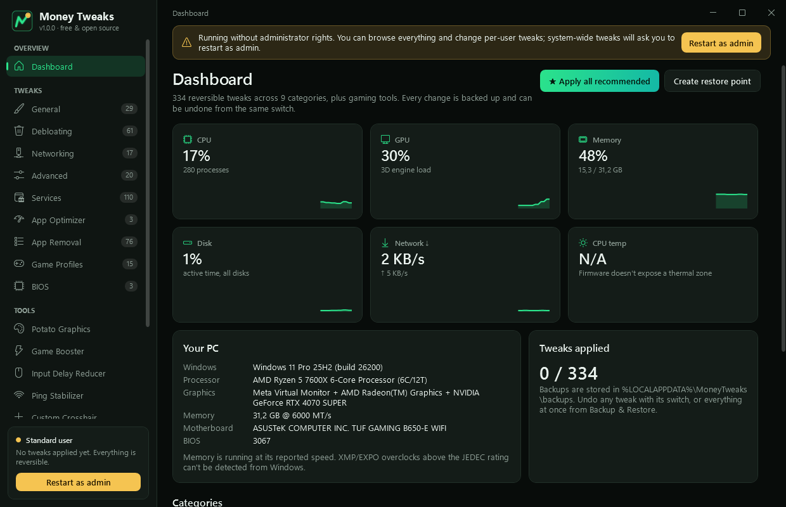

# Money Tweaks

Free, open-source Windows 10/11 tweaker for gamers. It has 334 reversible tweaks, gaming tools and a clean dark UI.
No accounts, no ads, no telemetry, no paid tiers.



**Website:** https://moneyman82.github.io/money-tweaks/ · **Download:** [latest release](https://github.com/MoneyMan82/money-tweaks/releases/latest)

> Money Tweaks is an independent project. It is not affiliated with, endorsed by or derived from EMTweaks, Microsoft
> or any game publisher. All code, text and artwork are original.

## Features

| Category | Tweaks | What it covers |
|---|---:|---|
| General | 29 | Visual effects, power plan, core parking, USB suspend, mouse acceleration, Explorer and taskbar, Game Mode/DVR |
| Debloating | 61 | Telemetry, advertising ID, activity history, suggestions/ads, Copilot/Recall/Widgets, Edge background, telemetry tasks |
| Networking | 17 | Nagle, network throttling, QoS reserve, TCP settings, DNS presets, adapter power saving, LSO, Teredo |
| Advanced | 20 | Memory compression, prefetch, timers, HAGS, fullscreen optimizations, GPU MSI mode, MMCSS, NTFS, HVCI |
| Services | 110 | Rarely used services set to Manual/Disabled, with the original start type backed up |
| App Optimizer | 3 | Launcher CPU priority, launcher auto-start, Search indexer priority |
| App Removal | 76 | Preinstalled Store apps and third-party bloat, plus OneDrive |
| Game Profiles | 15 | High CPU priority profiles for popular games (Image File Execution Options) |
| BIOS | 3 | Step-by-step guides: Resizable BAR, XMP/EXPO, C-States |

**Tools:** Potato Graphics · Game Booster · Input Delay Reducer · Ping Stabilizer · Custom Crosshair overlay ·
Startup Apps · Hardware Monitor · Backup & Restore · Activity Log.

### Safety model
- **Backups first.** Before any tweak changes anything, its current values are saved to
  `%LOCALAPPDATA%\MoneyTweaks\backups\<tweak>.json`. Re-applying never overwrites the original backup.
- **Transactional.** If any step of a tweak fails, the steps already done are rolled back.
- **Restore point.** With admin rights and System Protection on, a restore point is created before your first change
  each session.
- **Labels.** Every tweak is marked *Safe* or *Caution*. Caution tweaks show a warning and ask for confirmation.
- **Admin only when needed.** The app runs as a standard user. System-wide tweaks offer *Restart as admin*.
- **Logged.** Every change and error goes to `%LOCALAPPDATA%\MoneyTweaks\logs`.
- **Store apps.** Undo re-registers a removed app if Windows still has its files. Otherwise reinstall it from the Microsoft Store.

### Not included
These would need kernel drivers or paid/third-party content, so they're left out:
- Controller response curves
- Console (PlayStation/Xbox) guides
- Full temperature/fan sensors (the CPU temp tile only works when the firmware exposes an ACPI thermal zone)
- FPS counter

## Install
1. Download `MoneyTweaks-Setup.exe` (installer) or `MoneyTweaks-<version>-portable-win-x64.zip` from
   [Releases](https://github.com/MoneyMan82/money-tweaks/releases/latest).
2. Optional: verify the file against `SHA256SUMS.txt`:
   ```powershell
   Get-FileHash .\MoneyTweaks-Setup.exe -Algorithm SHA256
   ```
3. The builds are not code-signed, so SmartScreen may show *Windows protected your PC*. Click *More info → Run anyway*.
4. Start Money Tweaks. Click **Restart as admin** if you want to change system-wide settings.

**Requirements:** Windows 10 1809 (build 17763) or newer, or Windows 11, on x64. The .NET runtime is bundled in release builds.

## Build from source
Requirements: [.NET SDK 10](https://dotnet.microsoft.com/download/dotnet/10.0) and Windows.
[Inno Setup 6](https://jrsoftware.org/isinfo.php) is only needed for the installer.

```powershell
git clone https://github.com/MoneyMan82/money-tweaks.git
cd money-tweaks
dotnet build MoneyTweaks.sln -c Release
dotnet test tests\MoneyTweaks.Tests
dotnet run --project src\MoneyTweaks -c Release
```

Full release (self-contained EXE, portable ZIP, installer, SHA-256 checksums in `dist\`):

```powershell
powershell -ExecutionPolicy Bypass -File scripts\build-release.ps1
```

Opt-in integration test. It applies and then reverts every per-user (HKCU) tweak on your PC and checks the values are
restored exactly:

```powershell
$env:MT_INTEGRATION=1; dotnet test tests\MoneyTweaks.Tests --filter IntegrationTests
```

### Publishing a release
Push a version tag. The `Release` GitHub Actions workflow builds everything and attaches the files to a GitHub Release:

```powershell
git tag v1.0.0
git push origin v1.0.0
```

### Website (GitHub Pages)
The site lives in `docs/`. In the repository go to **Settings → Pages → Build and deployment**, pick
**Deploy from a branch**, then branch `main`, folder `/docs`. GitHub Pages on a free account requires a **public** repository.

## Project layout
```
src/MoneyTweaks.Core   engine (ops, backups, restore points), tweak catalog, feature logic
src/MoneyTweaks        WPF app (.NET 10)
tests/                 xUnit tests (catalog integrity, apply/undo/rollback, opt-in integration)
installer/             Inno Setup script
scripts/               release build script
docs/                  GitHub Pages website
```

## Adding a tweak
Add an entry to the right `src/MoneyTweaks.Core/Catalog/TweakCatalog.*.cs` file using the existing helpers
(`CU`, `LM`, `Cmd`, `Ps`, `ServiceStartOp`, …). Every op must be reversible. The tests enforce unique IDs and names,
real descriptions, and that every toggle has at least one op.

## License
MIT. See [LICENSE](LICENSE).
